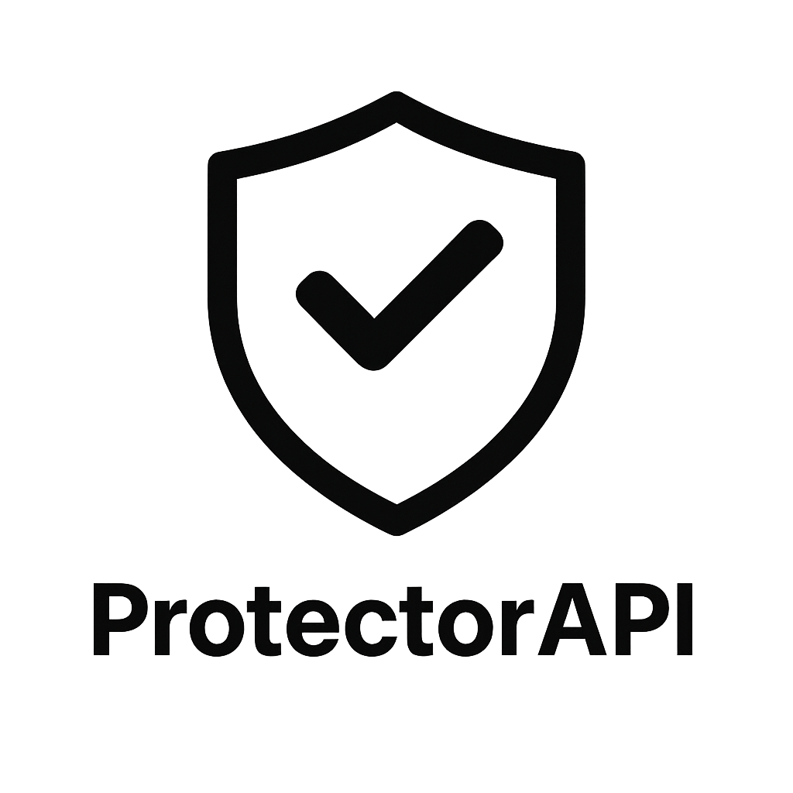

<div align="center">
  
  <h1>ProtectorAPI</h1>

<a href="https://modrinth.com/plugin/protectorapi"></a>
<a href="https://www.spigotmc.org/resources/protectorapi.126828/"></a>
<a href="https://hangar.papermc.io/lijinhong11/ProtectorAPI/"></a>
<a href="https://lijinhong11.gitbook.io/protectotapi/"></a>

  <p>
    用于对接各类保护插件的 API。<br>
    为开发者提供更标准、通用的保护查询接口。
  </p>
</div>

[English](README.md) | [简体中文](README_CN.md)

## 使用与开发

请参阅文档：https://lijinhong11.gitbook.io/protectotapi-cn/

## 构建

请确保已安装：

1. JDK 17。
2. JDK 25，用于编译 ExcellentClaims、FactionsUUID 和 LandClaimPlugin 适配器。

Gradle 会自动检测已安装的 JDK。使用项目自带的 Gradle Wrapper 构建：

```sh
./gradlew clean build
```

Windows 上执行 `gradlew.bat clean build`。

插件 JAR 生成在 `plugin/build/libs/ProtectorAPI-Plugin-<version>.jar`，其中 `<version>` 为项目版本号。
所有 ProtectorAPI 模块都以 Java 17 为目标版本，包括使用 JDK 25 编译的适配器。
保护插件依赖仅用于编译，不会打包进插件 JAR。

### 运行环境兼容性

ProtectorAPI 需要 Java 17 或更高版本。服务器和已安装的保护插件也必须支持所使用的 Java 版本。
当前集成的 ExcellentClaims 2.0.1 和 LandClaimPlugin 3.0.0 需要 Java 25，
FactionsUUID 0.7.0 需要 Java 21；对应适配器仅在这些插件启用时加载。

Java 17 下的编译依赖基准版本为 WorldGuard 7.0.9、WorldEdit 7.2.18、
PlotSquared 7.3.0 和 Bolt 1.0.580。

## 开发示例

### 异步保护检查

使用 `allowBreakAsync`、`allowPlaceAsync` 或 `allowInteractAsync` 检查保护，
无需在服务器主线程等待异步任务完成。这些方法均返回 `CompletableFuture<Boolean>`：

- `(Player, Location)`：检查目标位置的区域保护和方块保护。
- `(Player)`：在服务器主线程获取玩家位置，并检查该位置的区域保护。
- `findModuleAsync`、`findBlockModuleAsync` 和 `isInProtectionRangeAsync`：提供异步查询入口。

只有已确认线程安全的操作才会异步执行，其他操作仍在服务器主线程执行。
各适配器的支持情况和验证依据见[异步支持审计](ASYNC_SUPPORT_AUDIT_CN.md)。

### Chunk 检查

Chunk 检查使用可选的 `IChunkProtectionModule` 接口。
Chunk 模块的注册独立于区域模块和方块模块。
基于坐标的重载接收 `World`、`chunkX` 和 `chunkZ`，适配器可以在不调用 Bukkit 加载区块 API 的情况下查询未加载的区块：

```java
boolean protectedChunk = ProtectorAPI.isChunkProtected(world, chunkX, chunkZ);
ProtectorAPI.isChunkProtectedAsync(world, chunkX, chunkZ).whenComplete((protectedChunk, error) -> {
    // 使用结果进行 Bukkit 或玩家操作前，先切回服务器主线程。
});
```

只有底层保护插件提供了具备所需线程安全保证的区块坐标查询时，才应实现 `IChunkProtectionModule`。
通过 `supportsAsync(ProtectionCheck.CHUNK_LOOKUP)` 声明异步支持；未验证的 chunk 查询仍会在服务器主线程执行。

```java
Location target = block.getLocation(); // 在服务器主线程获取目标位置
ProtectorAPI.allowBreakAsync(player, target).whenComplete((allowed, error) -> {
    Bukkit.getScheduler().runTask(myPlugin, () -> {
        if (error != null) {
            myPlugin.getLogger().log(Level.WARNING, "保护检查失败", error);
            return;
        }
        if (player.isOnline()) {
            player.sendMessage(allowed ? "允许" : "拒绝");
        }
    });
});
```

Future 可能在主线程或异步线程完成，因此涉及 Bukkit 世界或玩家的操作应像上例一样切回服务器主线程。
不要在服务器主线程调用 `join()` 或 `get()` 等待结果。
异步结果无法事后取消一个同步 Bukkit 事件；应先完成保护检查，再执行延后的操作。
现有返回 `boolean` 的方法仍然同步执行。

返回的 Future 会完成为最终保护结果。检查失败或任务调度出错时，Future 会以异常结束，
不会返回“允许”。应在 ProtectorAPI 启用期间提交检查请求。

### 检查玩家能否放置方块

```java
Player player = ...;

boolean allow = ProtectorAPI.allowPlace(player);
```

如果需要检查玩家能否在指定位置放置方块，可以使用带位置参数的方法：

```java
Player player = ...;
Block block = ...;

boolean allow = ProtectorAPI.allowPlace(player, block.getLocation());
```

### 检查玩家能否破坏方块

```java
Player player = ...;

boolean allow = ProtectorAPI.allowBreak(player);
```

如果需要检查玩家能否破坏指定位置的方块，可以使用带位置参数的方法：

```java
Player player = ...;
Block block = ...;

boolean allow = ProtectorAPI.allowBreak(player, block.getLocation());
```

### 检查玩家能否与方块交互

**注意：RedProtect 没有更通用的交互 flag，因此使用 `redstone` flag 进行检查。**

```java
Player player = ...;

boolean allow = ProtectorAPI.allowInteract(player);
```

如果需要检查玩家能否与指定位置的方块交互，可以使用带位置参数的方法：

```java
Player player = ...;
Block block = ...;

boolean allow = ProtectorAPI.allowInteract(player, block.getLocation());
```
